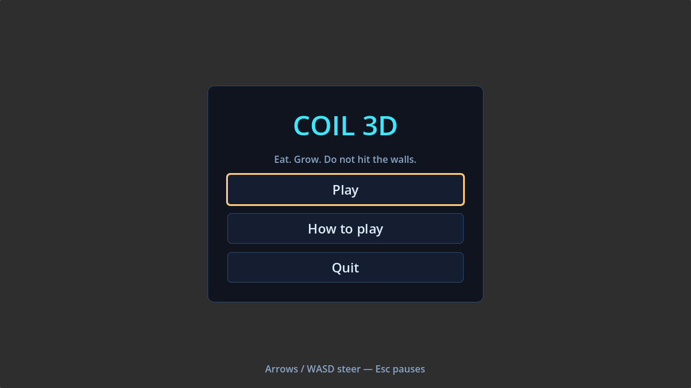
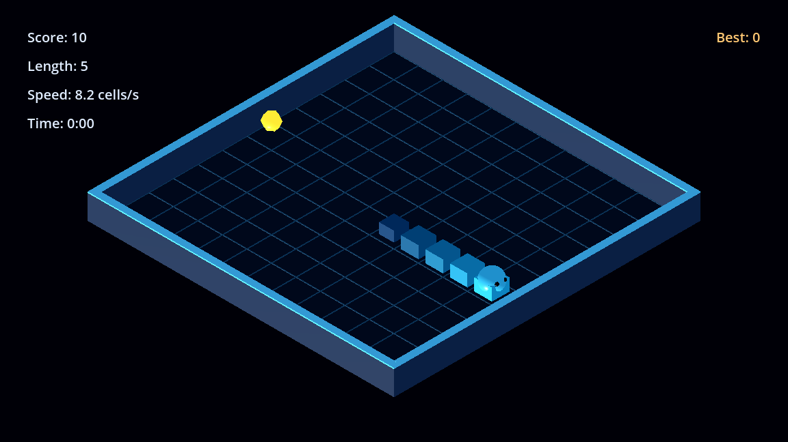
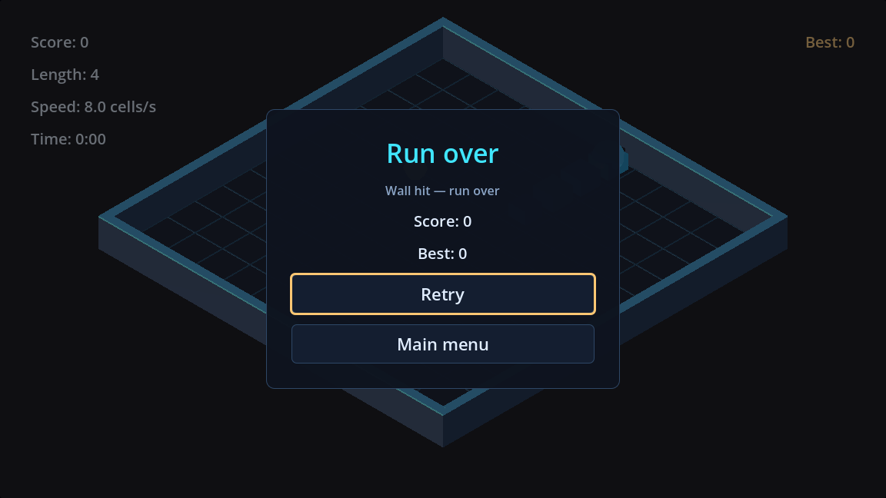

# Coil 3D

A small 3D snake in a glowing room. Eat, grow, and do not hit the walls.



| In a run | Once it ends |
|---|---|
|  |  |

- **One careful run**: grid movement, no instant reverse, speed climbs as you eat.
- **Isometric room**: Q/E rotate the view, the wheel zooms, the whole arena always fits.
- **Menu, HUD, pause and end panel** with keyboard focus and a best score that survives a restart.
- **Procedural audio**: synthesized cues for turning, eating, speeding up, crashing and buttons; no audio files.
- **Settings** for master and SFX volume, persisted to `user://save.json`.
- **Three platform presets**: Windows, Linux and Web.

Version 0.1.0.

## Controls

| Action | Keyboard |
|---|---|
| Turn | Arrow keys or `WASD` |
| Pause / back | `Esc` |
| Rotate camera | `Q` / `E` |
| Zoom | Mouse wheel |

## Build from source

Requires Godot 4.7 and Python 3.

```sh
godot --headless --path . --import
python scripts/studio.py test      # 400+ headless checks
python scripts/studio.py run
```

Exports use the presets in `export_presets.cfg`:

```sh
godot --headless --path . --export-release "Windows Desktop" build/windows/Coil3D.exe
godot --headless --path . --export-release "Linux" build/linux/Coil3D.x86_64
godot --headless --path . --export-release "Web" build/web/index.html
```

Export templates for 4.7.2 must be installed. A machine that keeps Godot outside
`PATH` sets `STUDIO_GODOT`; `studio.yaml` stays portable.

## Project layout

```
src/logic/     snake rules, arena data, save store: no nodes
src/game/      arena building, camera, session driver, HUD
src/ui/        main menu, how to play, pause, end panel, theme, focus
src/audio/     runtime-synthesized cues
src/perf/      opt-in frame-time sampling
scenes/        main shell, game scene, UI scenes
assets/data/   arenas
tests/         headless checks, input-event driver, visual diff and baseline
design/        the design set this build implements
production/    stories, evidence, releases
```

## Verification

- `python scripts/studio.py test` — 448 headless checks (rules, camera, save,
  UI routing, input events, frame-time parser).
- `python tests/visual_diff.py` — fresh capture against a committed baseline.
- GitHub Actions runs the same suite on Godot 4.7.2 for every push.

## How this was built

Developed by an agent studio on GitHub: issues became tickets, tickets ran in
isolated worktrees, and every pull request carried test logs and screenshots
from a real run. The studio kit is
[dsh-game-studio](https://github.com/yinhaox/dsh-game-studio), and this build
also served as the kit's mechanism probe.

## License

MIT. See [LICENSES.md](LICENSES.md).
